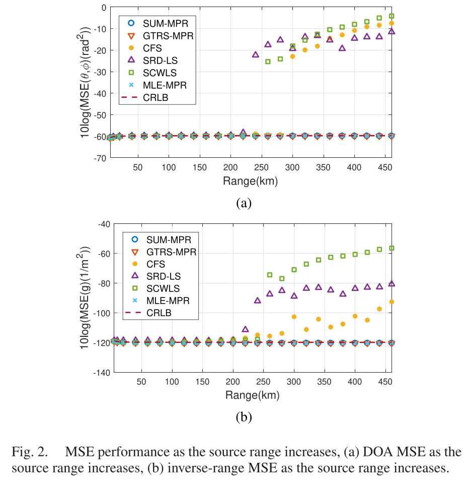
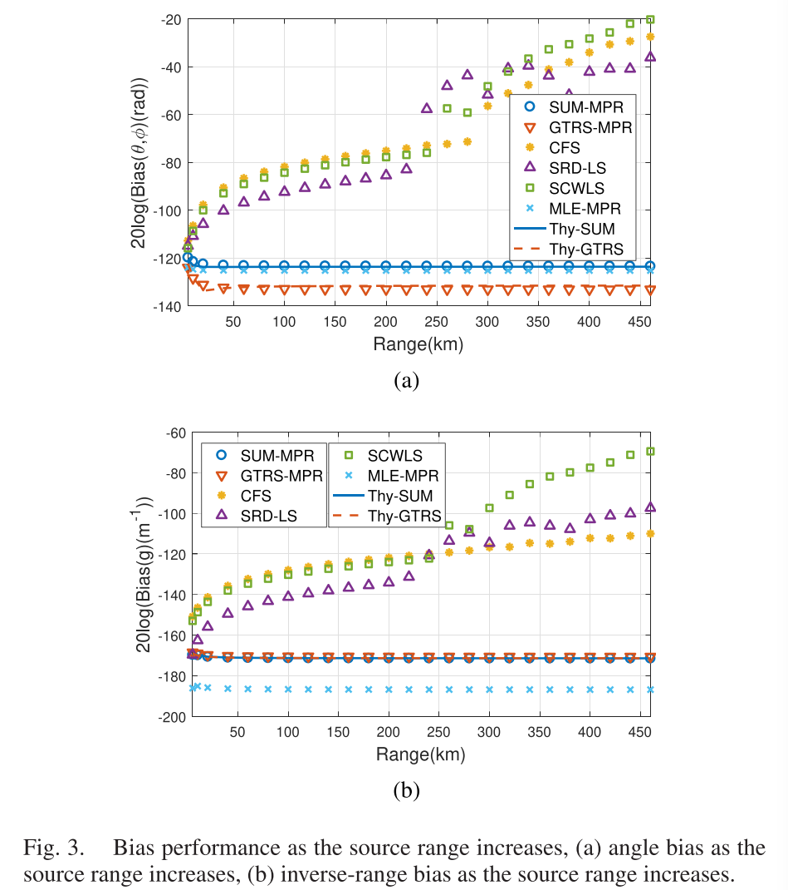
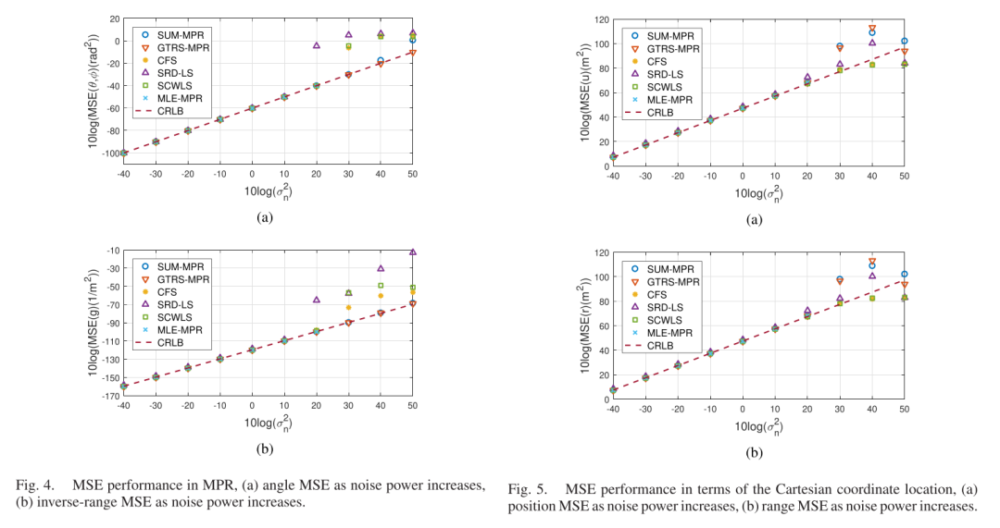
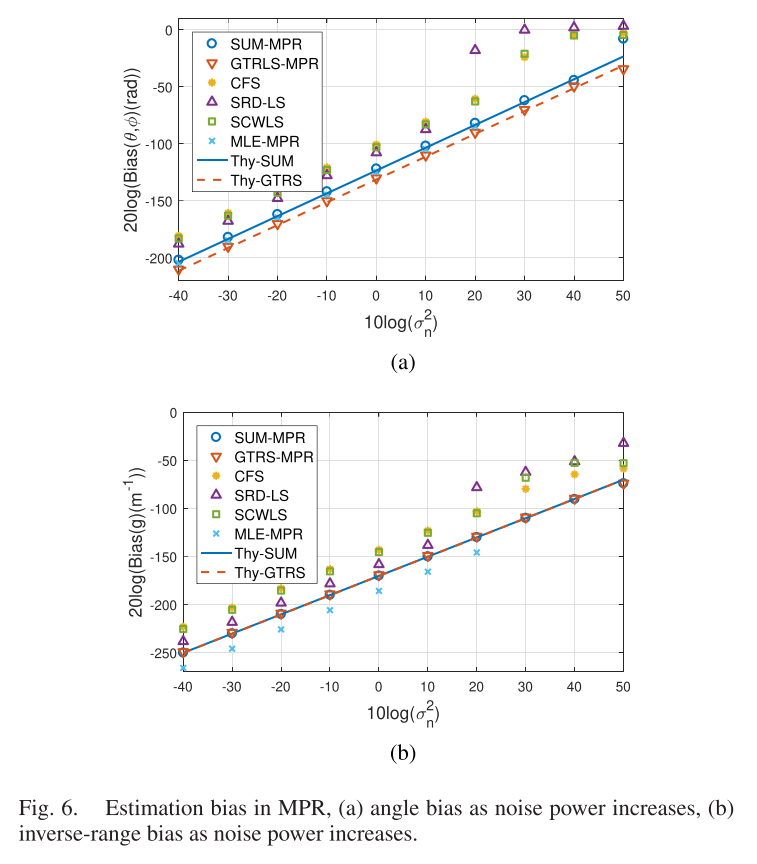
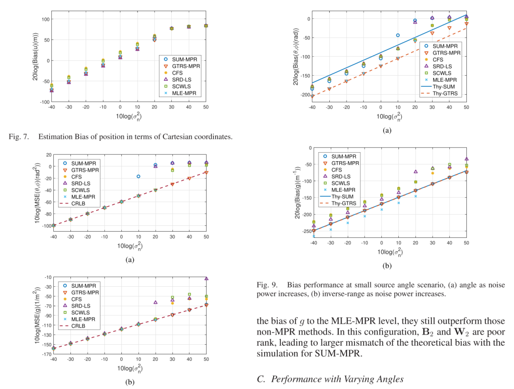
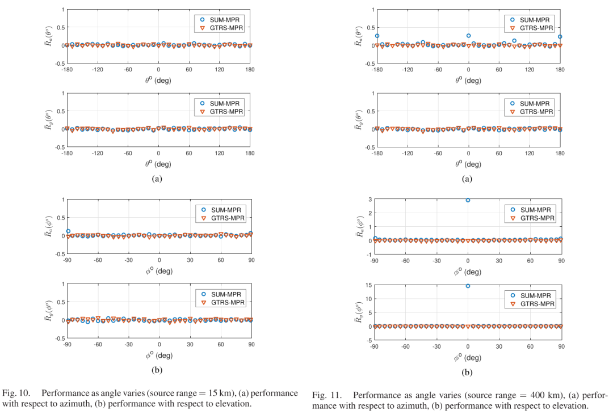

# [TDOA] Closed-form Solution and Analysis of Close and Far Source Time Difference Localization [with MATLAB Code]

Introduction: Time Difference of Arrival (TDOA) may be the most widely used method for passive positioning, where many receiving sensors listen to the transmitted signals from the source to identify its location [1]-[14]. Unlike the Received Time of Arrival (TOA), which requires time stamping of the transmitted signal, TDOA only requires the sensor to synchronize with a common time reference, such as the Global Positioning System (GPS) clock. Typically, each TDOA is discovered by cross-correlating signals from two sensors, creating a hyperbola trajectory that depicts possible source positions, with the two TDOA sensor positions serving as foci. The intersection of the hyperbola curves from different sensor pairs produces an estimate of the source position.
Time difference positioning is a nonlinear estimation problem. A related issue is threshold effect, where the estimation performance may suddenly deviate from the Cramer-Rao Lower Bound (CRLB) defined best accuracy when noise levels increase or the source is far from the sensor. Therefore, if the observational period is long enough to produce precise TDOA measurements and the source is in the near field where the source signal appears bending the wavefront, then TDOA positioning is effective.
TDOA point positioning is not feasible for far-field sources, as reflected by thresholding phenomena. If the ratio of the source range to the baseline of the sensor array is large, for example, when the angle between the ray from the source and the two ends of the sensor array is less than 1 degree, and the ratio is greater than 58, it is considered that the source is in the far field rather than the near field [15]. For far-field sources, the wavefront becomes linear because it is too far from the sensor. The hyperbola curves from the sensor pairs become almost parallel and intersect at very small angles. Its result is inherent limitations in determining the source range. In this case, we can only estimate the direction of arrival (DOA) of the source signal, corresponding to the asymptotic slope of the hyperbola curve.
Polarization-based Receiver Operating Characteristics (PROC) is a mature research area in array signal processing [16]-[20]. It is based on the phase difference between the transmitted narrowband signal and the elements of the sensor array, wherein the phase difference essentially corresponds to Time-Doppler Offset (TDOA). Classical methods for direction of arrival (DOA) estimation include Multi-Signal Classification (MUSIC) [21]-[25] and Estimation Algorithms via Rotation Invariance Techniques (ESPRIT) [26]-[28], with many variants developed over the years. DOA estimation is more effective for narrowband signals and has been extended to wideband observations [29]-[31]. Single-point positioning and DOA estimation require different processing. One must decide whether the source is close or far, which allows for point positioning or other applications of DOA estimation.
To avoid the need for prior knowledge, if the source is near or far, it may attempt to represent its location in polar coordinates rather than traditional Cartesian coordinates. The fundamental principle is that the polar coordinate angles of source position estimation can remain valid, although distance estimation becomes meaningless when the source is far away. Unfortunately, there is correlation between distance and angle estimation noise, and once distance estimation degrades as the source moves further away, the accuracy of angle estimation significantly drops.
To address this issue, literature [1] proposes an improved Polarization Representation Method (MPR) for TDOA localization. MPR is similar to polar coordinates except it uses range instead of range. When the source is close to the sensor, the inverse distance and angle produce a unique point position. When the source is far away, the inverse distance approaches zero, and its variance also approaches zero. The estimated noise in the inverse distance has little effect on angle estimation, essentially producing stable and accurate DOA estimates. Therefore, MPR enables the localization of sources within a unified algorithm without the need for knowledge about whether the source is close or far from the sensor.
The previous research [1] used the Gaussian-Newton iterative method to derive the maximum likelihood estimation (MLE) of the Time Difference of Arrival (TDOA) source localization in MPR. Similar to the iterative method, a good initialization is necessary for ensuring global convergence. Closed-form solutions are usually preferred as they have lower computational requirements and eliminate the issue of initialization. There are many closed-form solutions in the literature for Cartesian coordinate system time difference positioning, which are only applicable to near-field source scenarios. The closed-form solution for TDOA localization in MPR remains to be derived. This study proposes this research topic and provides an algebraic closed-form solution for single-source localization in MPR.
Developing a closed-form solution for MPR seems not straightforward because angles and distances are unknowns, and they are nonlinearly related and coupled with the measurement values. However, by shifting the coordinate origin to the location of the reference sensor for the TDOA measurement, we can convert the measurement equation into a pseudo-linear form. The estimation problem is reduced to a weighted least squares optimization problem under quadratic constraints, where the quadratic constraints are only related to the direction of arrival and not dependent on the distance.
This paper presents two methods for solving the optimization problem. One is the successive unconstrained minimization (SUM) method, where the first minimization ignores the optimization constraints, and the second minimizes using the constraint relationships between the unknowns to improve the previous estimate to produce the final solution. Another method is to apply Lagrange multipliers, forming long equations directly during the minimization process to impose constraints, and solving becomes equivalent to solving a 4th order polynomial in 2-D or a 6th order polynomial in 3-D. This solution essentially equates to the solution of the generalized trust region subproblem (GTRS) [32]. In both methods, the SUM solution is more attractive computationally than the Lagrangian (hereafter referred to as GTRS) solution.
The methods for both solutions are analyzed in detail with Mean Square Error (MSE) and bias, where MSE analysis is conducted in the first order and second order bias. The results of MSE analysis indicate that both methods can achieve CRLB performance in terms of source angle and distance from the noise level, which is moderate as the sound source range increases. If the noise level is high, the GTRS solution is more stable. Within a given range near the sound source, their performances are similar until the accuracy deviates from the CRLB before increasing noise levels. For small source arrival angles, GTRS provides smaller deviations than SUM.
The transformation of the weighted quadratic optimization measurement equation with secondary constraints in MPR is a new development, and the two closed-form solutions to it are also new. The existing closed-form solutions are only applicable to Cartesian coordinates, and when the source distance is large, they cannot provide reasonable estimates. In fact, [4] presents the GTRS positioning solution for least square minimization, which cannot achieve CRLB accuracy under correlated noise.
Another innovation of this paper is the theoretical research on the performance of the SUM and GTRS solutions in MPR. We analyze the GTRS solutions using perturbation method, which does not appear in the literature, and they well predict the performance of the solutions.
We start with the problem statement in Section 2. In Section 3, we derive the proposed method by converting the MPR positioning problem into a weighted quadratic minimization problem with secondary constraints. We present the SUM and GTRS solutions for constrained optimization problems. In Section 4, we provide a detailed analysis of the two solutions and compare their estimation accuracy with the CRLB. In Section 5, we present simulations supporting performance and theoretical analysis, and conclude in Section 6.
Figures are not included in this response.
The article presents a secondary optimization and secondary constraint for the MPR positioning problem in conversion, with a focus on introducing two technologies to obtain a closed-form solution from a single source. The first technology is SUM, and the second is GTRS, which is simpler than the latter. The derived solutions are applicable to both 2-D and 3-D scenarios. This article conducts detailed research on these two methods from two aspects: first-order mean square analysis and second-order bias analysis. Mean square analysis indicates that the solutions of these two methods can achieve CRLB accuracy under Gaussian noise and fully estimate the bias. When the noise level is high or the signal arrival angle is small, the GTRS-MPR solution often yields better results than the SUM-MPR solution. Simulation results verify the correctness of theoretical research and show that the proposed closed-form solution outperforms existing closed-form solutions in angle and reverse distance estimation, with smaller bias. They have MSE performance comparable to MLE-MPR and require less computation.
The developed algorithms assume that there are no outliers in the TDOA measurements of the source location assumption. The effectiveness of the proposed algorithms will be an interesting topic for further study when non-ideal TDOA measurement sets are available. The suggested solution is formulated as single-source localization. In the presence of multiple sources, if their signals do not intersect in time, frequency, or both [5], [41]-[43], then we can obtain the set of TDOA for each source. A challenging scenario is when signals from different sources do not intersect. The extension of the MPR formula and the multispectral solution of the solution are interesting topics for future investigations.

## Images

<!-- PAYMENT_BLOCK -->

## Get this dataset

- Payment link (Stripe): [Buy now](https://buy.stripe.com/3cs8yP7sY87d0vu9AB)
- Payment QR code: 

<!-- /PAYMENT_BLOCK -->
